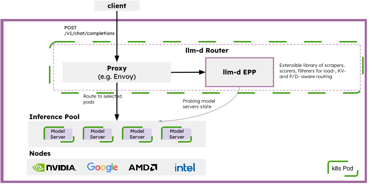

# Self-Hosted LLM on AWS EKS with llm-d and vLLM

In today's rapidly changing LLM era, running LLMs using plaforms such as AWS Bedrock, Azure Foundry is a norm. However we have use cases to run LLM models, especially open weigh models, to have more controle over data, latency, and cost. This repo shows the alternative option which is quickly becoming an industry standard: a **self-hosted, production-shaped inference stack** on Kubernetes using the **llm-d router** and the **vLLM** serving engine. We can bring it up with Terraform and a few `kubectl` commands.

This repo follows the llm-d [optimized baseline guide](https://github.com/llm-d/llm-d/blob/main/guides/optimized-baseline/README.md) and with a deliberately small footprint of single GPU and a small model to showcase the building blocks that would scale up in production.



## Core Architecture
The llm-d architecture is built around three primary concepts: the Router, the InferencePool, and the Model Server.

- **llm-d Router** - The intelligent entry point for inference requests. It provides LLM-aware load balancing, request queuing, and policy enforcement. It is composed of two functional parts:

  - **Proxy** A high-performance L7 proxy (typically Envoy) that accepts user requests and consults the EPP via the ext-proc protocol to determine the optimal destination.

  - **Endpoint Picker (EPP)**: The routing engine that scores and selects model server pods based on real-time metrics, KV-cache affinity, and configured policies.

- **InferencePool** - The API that defines a group of Model Server Pods sharing the same model and compute configuration. Conceptualized as an "LLM-optimized Service", it serves as the discovery target for the Router.

- **Model Server** - The inference engine (such as vLLM or SGLang) that executes the model on hardware accelerators (GPUs, TPUs, HPUs).

## Implementation


### AWS layer (Terraform)
* **VPC:** Standard VPC with 2 public and 2 private subnets. Worker nodes run in the private subnets and reach the internet through a **single NAT gateway**.
* **EKS:** Kubernetes `1.36` with a public API endpoint, **IRSA** enabled, and the managed add-ons vpc-cni, kube-proxy, and coredns.
* **Node groups:** both run on **Spot** capacity.
  * `general_node_group_1`: AL2023 x86, 1–2 nodes, for the router and system pods.
  * `gpu_node_group_250`: AL2023 NVIDIA AMI on **`g6.xlarge` (1x NVIDIA L4, 24 GB)**, 1–2 nodes, with a 100 GiB gp3 disk for container images and model weights.

### Kubernetes layer (llm-d optimized baseline)
1. **Client** sends an OpenAI-compatible `POST /v1/completions` request.
2. **Proxy** (llm-d router, `llm-d-router-standalone` Helm chart) receives the request and asks the **EPP** (Endpoint Picker) which model serving pod would be best to forward to.
3. **EPP** checks model-server state (queue depth, KV-cache utilization, prefix-cache hits) and picks the best pod. It's built on the Gateway API Inference Extension `InferencePool` CRD.
4. **Inference pool** is a `decode` Deployment running `vllm serve Qwen/Qwen2.5-1.5B`: 1 replica, 1 GPU, tensor-parallel 1. It pulls weights from Hugging Face using the `llm-d-hf-token` secret.
5. **NVIDIA device plugin** exposes `nvidia.com/gpu` so the scheduler can place vLLM pods on GPU nodes.

Scaling out means adding vLLM replicas (and GPU nodes). The EPP spreads traffic across them with no client changes.

## Cost

| Component | Pricing | ~Hourly |
|-----------|---------|---------|
| EKS control plane | $0.10/hr | $0.100 |
| NAT gateway (single) | $0.045/hr + $0.045/GB processed | $0.045 + data |
| GPU node `g6.xlarge` Spot (on-demand ~$0.80/hr) | Spot, varies | ~$0.25–0.40 |
| General node `t3.medium` Spot (on-demand ~$0.042/hr) | Spot, varies | ~$0.013 |
| EBS gp3 100 GiB + 20 GiB root ($0.08/GB-month) | prorated | ~$0.013 |
| **Total (minimum footprint)** | | **~$0.42–0.57/hr** |

If you leave the cluster running and forget it, it costs about **$10–14 per day**.

## Prerequisites

* **Client tools** installed on your local system:
  * **Terraform** `1.7.5` (pinned in `.tool-versions`; use `asdf install` if you use asdf).
  * **AWS CLI v2**, authenticated to the target account (`aws sts get-caller-identity`).
  * **kubectl**, compatible with the cluster's Kubernetes version (`1.36`).
  * **Helm 3.8+**, needed for the OCI chart `oci://ghcr.io/llm-d/charts/llm-d-router-standalone` and the NVIDIA device plugin chart.
  * **git** and **bash**.
* **AWS account and permissions:**
  * IAM permissions to create VPC, EKS, EC2, and IAM resources.
  * An **S3 bucket for Terraform state**, passed to `terraform init` with `-backend-config` (see step 2).
  * **`eks_admin_user`** set to your IAM user or role ARN (in `terraform/variables.tf` or with `-var`). Terraform uses it to grant EKS cluster-admin access.
* **Accelerators:** the default setup needs **1 NVIDIA GPU** (1 replica of `Qwen/Qwen2.5-1.5B`, `--tensor-parallel-size=1`) on a `g6.xlarge`. Check that your **Spot G-instance vCPU quota** in `us-east-2` is at least 4 (8 if the GPU node group scales to 2). 
* **Hugging Face token:** create a [Hugging Face token](https://huggingface.co/settings/tokens) and export it as `HF_TOKEN` in your shell. It is stored in the `llm-d-hf-token` Kubernetes secret.

## Deployment Steps

### Clone repo

1. Clone this GitHub Repo

    `git clone https://github.com/mohzim/self-hosted-llm.git`


### Setup resources on AWS Cloud   

2. Initialize terraform

    `terraform -chdir=terraform init -backend-config="bucket=mohzim-terraform" -backend-config="key=terraform-self-hosted-llm-tfstate" -backend-config="region=ap-south-1" -input=false`

3. Verify resource creation
        
    `terraform -chdir=terraform plan -input=false`

4. Create resources in AWS Cloud
        
    `terraform -chdir=terraform apply -input=false`

### Setup kubectl to connect to AWS Kubernetes Cluster 

5. Update your local kubeconfig (Replace with you eks clustername from step 4 output)
    ```
    aws eks update-kubeconfig --region us-east-2 --name "eks-cluster-name"
    kubectl get pods
    ```

### Setup k8s resources

6. Add your Hugging Face Token

    `export HF_TOKEN="YOUR-HF-TOKEN" `

7. Source environment variables

    `source scripts/env.sh`

8. Install the Gateway API Inference Extension CRDs and create target namespace for installation

    ```
    kubectl apply -f https://github.com/kubernetes-sigs/gateway-api-inference-extension/${GAIE_URL}/v1-manifests.yaml
    kubectl create namespace ${NAMESPACE} --dry-run=client -o yaml | kubectl apply -f -
    kubectl create secret generic llm-d-hf-token \
      --from-literal="HF_TOKEN=${HF_TOKEN}" \
      --namespace "${NAMESPACE}" \
      --dry-run=client -o yaml | kubectl apply -f -
    ```

9. Install llm-d router
    ```
    helm install ${GUIDE_NAME} \
      ${ROUTER_STANDALONE_CHART} \
      -f ${ROUTER_BASE_VALUES} \
      ${MONITORING_VALUES} \
      -f ${ROUTER_VALUES} \
      -n ${NAMESPACE} --version ${ROUTER_CHART_VERSION}
    ```

10. Install nvidia device plugin on eks nodes
    ```
    helm repo add nvdp https://nvidia.github.io/k8s-device-plugin
    helm repo update
    helm search repo nvdp --devel
    helm upgrade -i nvdp nvdp/nvidia-device-plugin \
    --namespace nvidia-device-plugin \
    --create-namespace \
    --version 0.20.1
    ```

11. Deploy Model Server
    ```
    kubectl apply -n ${NAMESPACE} \
    -k ${REPO_ROOT}/llm-d-sparse/guides/${GUIDE_NAME}/modelserver/${ACCELERATOR_TYPE}/${MODEL_SERVER}/${INFRA_PROVIDER}/
    ```

## Testing with Curl
12. Get the IP of the Proxy
    ```
    export IP=$(kubectl get service ${GUIDE_NAME}-epp -n ${NAMESPACE} -o jsonpath='{.spec.clusterIP}')
    ```

13. Send Test Requests
    Send a completion request from a temporary pod inside the cluster (model-aware; set MODEL to the name you want to query, e.g. Qwen/Qwen3-32B or openai/gpt-oss-120b):
    ```
    kubectl run curl-test --rm -i --restart=Never \
      --image=${CURL_TEST_IMAGE} \
      --namespace="${NAMESPACE}" \
      --env="IP=${IP}" \
      --env="MODEL=${MODEL}" \
      -- /bin/sh -c 'curl -sS -X POST "http://${IP}/v1/completions" -H "Content-Type: application/json" -d "{\"model\": \"${MODEL}\", \"prompt\": \"How are you today?\"}"'
    ```

## Clean-up
14. Destroy cloud resources

    `terraform -chdir=terraform destroy -input=false -auto-approve`

## To-do-list
1. Add licensing note for llm-d parser
2. Update terraform init command without any backend prerequisites.
3. Configure GitHub Actions workflows to run Terraform `plan`, `apply`, and `destroy` (e.g. plan on PR, apply on merge/manual approval, destroy via `workflow_dispatch`), using OIDC to assume an AWS role instead of storing static credentials. 

## Repo Structure

```
.
├── README.md
├── .tool-versions                 # Pinned tool versions (terraform 1.7.5)
├── img/
│   └── llm-d-arch_v1.jpg          # Architecture diagram
├── scripts/
│   ├── env.sh                     # Exports guide, namespace, model, chart and CRD versions
│   └── llm-d-setup.sh             # Sparse-clones only the needed llm-d guide files
├── terraform/
│   ├── versions.tf                # Provider and Terraform version constraints, S3 backend
│   ├── variables.tf               # Region, k8s version, VPC CIDR, EKS admin user
│   ├── vpc.tf                     # VPC, subnets, single NAT gateway
│   ├── eks-cluster.tf             # EKS cluster, add-ons, general and GPU node groups
│   ├── eks-admin.tf               # EKS access entry and admin policy
│   ├── security-groups.tf         # Worker management security group
│   └── outputs.tf                 # Cluster name, endpoint, region, OIDC ARN
└── llm-d-sparse/guides/           # Trimmed copy of the llm-d repo
    ├── env.sh
    ├── optimized-baseline/
    │   ├── router/                # Router Helm values for this guide
    │   └── modelserver/gpu/vllm/base/   # Kustomize overlay: vLLM args, model, GPU resources
    └── recipes/
        ├── router/base.values.yaml      # Base router Helm values
        └── modelserver/                 # Base decode Deployment, ServiceAccount, images
```